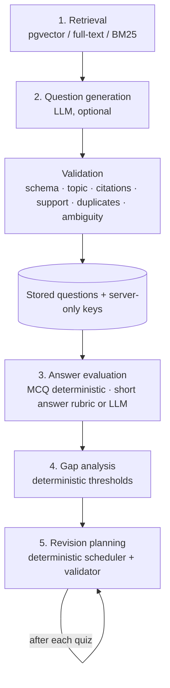

# AI workflow

GapFinder separates five concerns. Only two of them use a language model, and both are optional.

## 1. Retrieval
See `RAG_PIPELINE.md`. Pure data access; no generation.

## 2. Question generation (`lib/ai/tasks.ts → generateQuestionsFromPassages`)
Input: one topic and its retrieved passages. Output JSON with type, difficulty, prompt, 4 options, correct index, explanation, per-option misconception rationales, and source aliases.
`lib/validation/question.ts` then rejects anything that fails: Zod schema, known topic ID, citations resolving to retrieved chunks, ≥ 1 valid citation, 4 distinct options, no “all/none of the above”, keyed answer supported by cited text, no duplicate prompts. Accepted options are shuffled deterministically so answer position carries no signal. Rejections are counted and reported to the student. If too few valid questions remain, the quiz start returns `422 insufficient_evidence`.

Without an AI key, quizzes use stored questions only (the seeded sample bank).

## 3. Answer evaluation (`lib/evaluation/grade.ts`, `lib/ai/tasks.ts`)
- MCQ: exact index comparison on the server. The misconception tied to the chosen wrong option is recorded.
- Short answer: key-point rubric (each key point lists alternative phrasings; covered if all its content words appear) → partial credit. With Gemini configured, an LLM evaluator returns score / understood / missing / misconceptions, validated by Zod. Student text is fenced as untrusted; if the rubric finds no key point at all, the LLM score is capped at 0.5. Any evaluator failure falls back to the rubric.
- An answer counts as correct at ≥ 0.7 credit.

Evaluation never sets mastery labels.

## 4. Gap analysis (`lib/diagnosis/`)
For each topic (sub-topic answers roll up to units): all-time accuracy, plus *recent accuracy* over the last 6 answers. Label from recent accuracy: weak < 50 %, developing 50–79 %, strong ≥ 80 %, and “Not enough evidence” below 3 answers. These are starting heuristics, not validated cut-offs; they live in `config.ts`. A snapshot per touched topic is stored after each attempt (`topic_mastery_history`). `explainMastery` produces the sentence shown to the student from the same numbers.

## 5. Revision planning (`lib/revision/planner.ts`)
Need per unit from its label and accuracy (weak 120–240 min, developing 60–120, strong 20 review, unassessed 15-min diagnostic), scaled by syllabus weightage, reduced by study completed since the last assessment. If total need exceeds the time to the exam (capped at a 21-day horizon), strong reviews are dropped first, then everything is scaled down, with warnings. Blocks (≤ 45 min study, practice, retest after the last study day) are placed round-robin in priority order into days without exceeding the daily limit. `validatePlan` rejects any over-limit day, non-positive duration or out-of-window task.

After each quiz the plan is rebuilt from the new mastery; completed tasks move to history; the UI shows per-topic minute changes.
