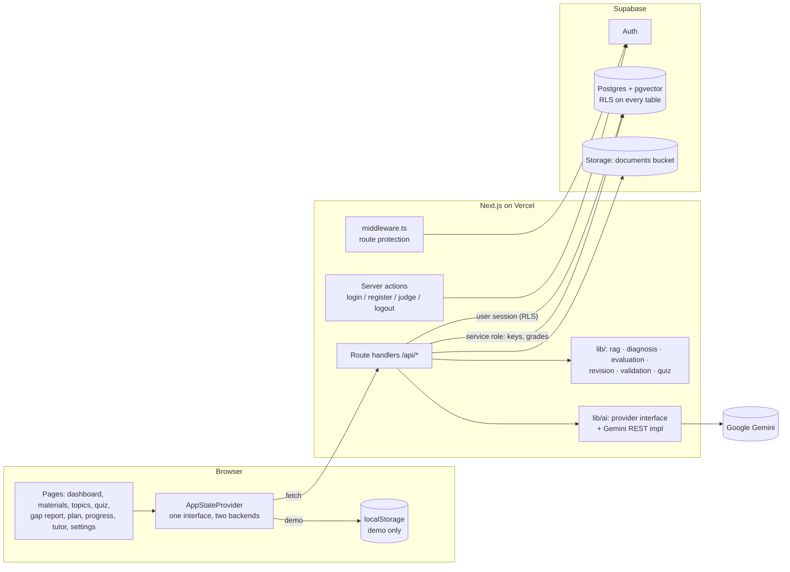

# Architecture

## Layers

| Layer | Location | Notes |
| --- | --- | --- |
| Pages | `app/(app)/*/page.tsx` → `features/*/…View.tsx` | Thin server entries render client views. |
| State | `features/app-state/` | `AppStateProvider` exposes the same actions in both modes; `demo-logic.ts` holds pure transitions (unit-tested). `useDerived` computes mastery client-side with the same library the server uses. |
| API | `app/api/**/route.ts` | Validate with Zod, authorize, call `lib/`, map errors via `lib/api/respond.ts`. |
| Business logic | `lib/rag`, `lib/diagnosis`, `lib/evaluation`, `lib/revision`, `lib/validation`, `lib/quiz`, `lib/syllabus` | Pure TypeScript, no framework or vendor code. |
| Data (live) | `lib/data/live-*.ts` | Supabase queries and row mapping. |
| AI | `lib/ai` | `AIProvider` interface; Gemini implementation; grounded task prompts. |

## Database

Tables: `profiles`, `documents`, `document_chunks` (content, page, section, `topic_ids uuid[]`, `embedding vector(768)`, generated `fts`), `topics` (self-referencing hierarchy), `questions` (public fields + citations), `question_keys` (answer keys), `quiz_attempts`, `student_answers` (score, evaluator, feedback JSON), `topic_mastery_history`, `revision_plans` (one active per user), `revision_tasks`.

Functions: `match_chunks` (cosine similarity, `security invoker`, scoped to `auth.uid()`), `search_chunks_fulltext`. Trigger `handle_new_user` creates profiles.

## Security boundaries

- **Routes**: `middleware.ts` redirects anonymous visitors; `app/(app)/layout.tsx` re-checks on the server; every API handler calls `requireUser()` (live) or `requireDemo()` (demo), which uses `supabase.auth.getUser()` (JWT validated by Supabase, not just the cookie).
- **Data**: RLS on every table (`user_id = auth.uid()`). Students may *read* questions, attempts, answers and mastery but not write them; those writes use the service role on the server, always with an explicit `user_id` filter. `question_keys` has RLS with **no** client policies.
- **Answer keys**: never in quiz-start responses; demo bank lives in server-only modules; a test asserts public question objects contain no key fields.
- **Secrets**: only `NEXT_PUBLIC_SUPABASE_URL` / anon key reach the browser. The judge password is used inside a server action. `/api/health` exposes booleans only (tested).
- **Untrusted content**: documents and student answers are wrapped in tagged blocks with explicit “data, not instructions” rules; source tags inside documents are stripped; the model refers to sources by alias and only aliases that map to retrieved chunks survive; short-answer AI scores are capped when no key point is present.
- **Integrity**: duplicate submissions blocked by `unique(attempt_id, question_id)` plus a conditional status update (409); demo blocks re-submitting an attempt ID.

## Main data flow (live)

Upload → `POST /api/documents` → store file → extract → chunk → link to topics → embed → insert chunks → status.
Quiz → `POST /api/quiz/start` → pool + (retrieve → generate → validate → save) → attempt → public questions.
Submit → `POST /api/quiz/:id/submit` → load keys (service role) → grade → insert answers → complete attempt → recompute mastery → snapshot → re-plan.
